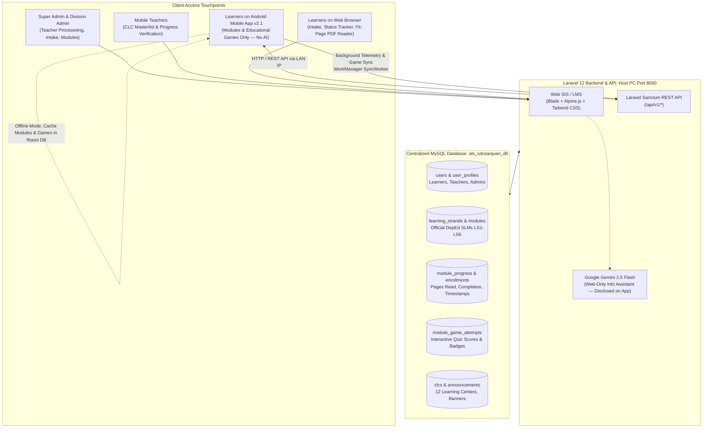

# SDO San Juan City — Alternative Learning System (ALS)
### Unified Web Student Information System (SIS), Admin LMS & Mobile Backend API

[](https://www.php.net/)
[](https://laravel.com/)
[](https://vitejs.dev/)
[](https://www.mysql.com/)
[](https://www.deped.gov.ph/)
[](https://github.com/Renren051/als_sdosanjuan_modules_apk)
[-success?style=flat)]()

---

## 📌 Executive Overview

Under the mandate of the **Department of Education (DepEd)** and **Republic Act No. 11510 (The Alternative Learning System Act)**, this ecosystem serves the **Schools Division Office (SDO) of San Juan City** to empower Out-of-School Youth and Adults (OSYA) across all 21 barangays.

The platform operates as a **single, unified dual-platform system** powered by a **shared central MySQL database**:
1. **Web-Based Student Information System (SIS) & Administrative Portal:** Multi-role governance portal handling digital intake (DepEd ALS Form 2), document verification, Community Learning Center (CLC) allocation, hero banner management, module authoring/publishing, and automated DepEd masterlist exports (ALS Form 1 & Form 2).
2. **Centralized Backend API:** High-performance Laravel Sanctum REST API serving data, authentication, binary PDF streaming, telemetry ingestion, and educational game score synchronization.
3. **Android-Based Modular LMS (Native Mobile App v2.1):** An offline-first mobile application designed for OSYA learners with limited or intermittent internet connectivity, focused strictly on **Self-Learning Modules (SLMs)** and **Interactive Gamified Learning (Educational Mini-Games)** with local SQLite/Room caching and background telemetry synchronization. *(Note: AI features are officially disclosed/decommissioned from the mobile app to ensure complete offline autonomy, zero data costs, and dedicated focus on curriculum content).* Pre-built standalone package available as `ALSSDOSanJuan_v2.1_alpha.apk`.

---

## 🗄️ Single Shared Database Architecture

Both the **Web SIS / LMS** and the **Android Mobile App (v2.1)** operate on the **EXACT SAME MySQL database** (`als_sdosanjuan_db`). There is zero data segregation or secondary synchronization delays:



### How the Shared Database Works in Practice:
- **Unified User Accounts & Authentication:** Every learner and teacher registered through the Web Intake Wizard (or created by administrators) is immediately stored in the `users` table. They can log into **both the Web Portal and the Android App** using their email address or username and password.
- **Centralized Module Control:** When an Administrator uploads, publishes, or updates an official DepEd module on the Web SIS (`/admin/modules`), the Android app immediately receives the updated module, title, file URL, and strand count without requiring an app store update.
- **Bi-Directional Reading Telemetry:** When a learner reads a module on Android (even without internet connection), their reading position (`last_page_read`) and completion status (`is_completed`) are logged into local SQLite. When the mobile device reconnects to Wi-Fi or mobile data, the Android `SyncWorker` sends this data to `/api/v1/learner/sync-progress`, instantly updating the web database so Teachers and Admins can see the progress on their web dashboards.
- **Gamified Learning & Score Synchronization:** When a learner completes or plays an interactive educational game/quiz on Android, game scores, mastery badges, and attempts are stored in local SQLite (`module_game_attempts`). When online, `SyncWorker` transmits these records to `/api/v1/learner/sync-game-scores`, giving Mobile Teachers verifiable proof of comprehension.
- **App AI Disclosure Notice:** The mobile application is purely focused on **Modules** and **Games**; the AI chatbot is intentionally disclosed/omitted to preserve device battery, avoid data requirements, and provide a distraction-free learning environment.

---

## 🛠️ Technology Stack

| Layer | Component | Details |
| :--- | :--- | :--- |
| **Backend & API** | Laravel 12.x | PHP 8.2+ (Visual C++ 2019 x64), Eloquent ORM |
| **Authentication** | Laravel Sanctum | State-based session cookies for Web; Bearer Tokens for Android |
| **Database** | MySQL 8.0 / MariaDB | Shared database `als_sdosanjuan_db` via XAMPP |
| **Web Frontend** | Blade + Vite v7.x | Tailwind CSS, Alpine.js, Plus Jakarta Sans, Playfair Display |
| **PDF Generation** | DomPDF | Official DepEd Form 1 (Masterlist) & Form 2 (Enrolment Profile) |
| **Gamified Learning** | Interactive Module Games | Module-linked comprehension quizzes, offline scoring, and `module_game_attempts` sync |
| **AI Assistant (Web Only)** | Google Gemini 2.5 Flash | Optional Web-only info assistant; **disclosed/decommissioned from the mobile application** |
| **Mobile App (v2.1)** | Native Android | Kotlin 2.0, Jetpack Compose, Material 3, Room SQLite, Retrofit 2, WorkManager (`ALSSDOSanJuan_v2.1_alpha.apk`) |

---

## 💻 Local Development Setup (Web SIS & Backend)

### 📋 Prerequisites
1. **PHP 8.2 or higher** (Included in XAMPP; extensions required: `pdo_mysql`, `mbstring`, `openssl`, `fileinfo`, `gd`, `zip`, `curl`).
2. **Composer 2.x** ([getcomposer.org](https://getcomposer.org/)).
3. **Node.js 18+ & npm** ([nodejs.org](https://nodejs.org/)).
4. **MySQL 8.0 / MariaDB** (Default XAMPP port 3306).
5. **Git** ([git-scm.com](https://git-scm.com/)).

---

### 📥 Step-by-Step Installation Guide

#### 1. Clone the Repository & Checkout Branch
Open PowerShell or Git Bash:
```powershell
git clone --branch preview-deployment --single-branch https://github.com/Renren051/als_sdosanjuan.git als_sdosanjuan
cd als_sdosanjuan
```

#### 2. Configure Environment (`.env`)
Copy the environment template:
```powershell
cp .env.example .env
```
Open `.env` in your editor and verify your database configuration matches your local XAMPP MySQL setup:
```env
APP_NAME="ALS SDO San Juan City"
APP_ENV=local
APP_KEY=
APP_DEBUG=true
APP_URL=http://localhost:8000

DB_CONNECTION=mysql
DB_HOST=127.0.0.1
DB_PORT=3306
DB_DATABASE=als_sdosanjuan_db
DB_USERNAME=root
DB_PASSWORD=

# Gemini API Key for ALSJay Virtual Assistant
GEMINI_API_KEY=your_gemini_api_key_here
```

#### 3. Install Dependencies
```powershell
composer install
npm install
```

#### 4. Generate Application Key & Link Storage
```powershell
php artisan key:generate
php artisan storage:link
```
> [!IMPORTANT]
> Running `php artisan storage:link` is **required**. It creates a symbolic link from `public/storage` to `storage/app/public`, allowing uploaded module PDFs, hero banners, and student documents to be downloaded and streamed by both web browsers and the Android application.

#### 5. Create Database, Run Migrations & Seed Default Data
Ensure **MySQL is running in your XAMPP Control Panel**, then run:
```powershell
# Create the database in MySQL (if not yet created):
mysql -u root -e "CREATE DATABASE IF NOT EXISTS als_sdosanjuan_db CHARACTER SET utf8mb4 COLLATE utf8mb4_unicode_ci;"

# Run migrations and seed default administrative accounts, CLCs, and sample learners:
php artisan migrate:fresh --seed
```
*Note: The seeder also imports official DepEd Elementary modules into the shared repository automatically.*

#### 6. Compile Frontend Assets
```powershell
# For production asset compilation:
npm run build

# Or for active local development with hot module replacement (HMR):
npm run dev
```

---

## 🌐 Connecting Android to the Backend (CRITICAL NETWORK SETUP)

Because the Android application runs on either an Android Emulator or a physical Android smartphone connected via Wi-Fi, the Laravel server **must accept incoming connections from other devices on your local network**.

### 1. Launch Laravel with `--host=0.0.0.0`
```powershell
php artisan serve --host=0.0.0.0 --port=8000
```
> [!WARNING]
> If you run `php artisan serve` without `--host=0.0.0.0`, Laravel defaults to `127.0.0.1` (localhost only). Physical Android phones will **NOT** be able to connect and will report connection timeouts or network errors!

### 2. Determine Your Host Computer's Local IP Address
In PowerShell, run:
```powershell
ipconfig
```
Look for your active network adapter (e.g., **Wireless LAN adapter Wi-Fi** or **Ethernet**) and find your **IPv4 Address**:
```text
IPv4 Address. . . . . . . . . . . : 192.168.1.15
```

### 3. Windows Firewall Configuration
If your physical phone cannot reach `http://<YOUR_PC_IP>:8000`, open **Windows Defender Firewall with Advanced Security** and add an **Inbound Rule**:
- **Rule Type:** Port
- **Protocol & Ports:** TCP, Specific local ports: `8000`
- **Action:** Allow the connection
- **Profile:** Check Domain and Private (ensure your Wi-Fi network profile is set to Private).

---

## 👥 Seeded Demo Accounts (Shared Database)

All accounts below are pre-configured in `database/seeders/UserSeeder.php` and can be used on **both the Web Portal and the Android App**. The system prioritizes signing in using **Email Address** (with username fallback supported):

| Role / Track | Primary Login Email | Username / LRN | Password | Program Track / Assignment | Access Capabilities |
| :--- | :--- | :--- | :--- | :--- | :--- |
| **Super Administrator** | `superadmin.als@deped.gov.ph` | `superadmin_als` | `Password123!` | Division IT / All CLCs | Full System Control, Mobile Teacher Provisioning (`/superadmin/teachers`), CLC Assignments, Account Resets |
| **Division Administrator** | `admin.als@deped.gov.ph` | `admin_als` | `Password123!` | SDO San Juan Division Office | Enrollment Intake Queue, Document Verification, Banner Manager, Module Uploading & Publishing, DepEd Form 1 & 2 Exports |
| **Mobile Teacher** | `juan.delacruz@deped.gov.ph` | `teacher_juan` | `Password123!` | West Crame CLC | Assigned CLC Roster, Learner Attendance, Document Verification |
| **Mobile Teacher** | `alyssa.reyes@deped.gov.ph` | `teacher_alyssa` | `Password123!` | Batis CLC | Assigned CLC Roster, Learner Attendance, Document Verification |
| **Learner (BLP)** | `learner.blp@deped.gov.ph` | `learner_blp`<br>*(LRN: `136542240010`)* | `Password123!` | Basic Literacy Program (BLP) | Enrolled Learner, BLP Modules, Telemetry Sync |
| **Learner (Elementary)** | `learner.elem@deped.gov.ph` | `learner_elem`<br>*(LRN: `136542240020`)* | `Password123!` | A&E Elementary (Grades 1–6) | Enrolled Learner, Elementary SLM Modules (English & Filipino), Telemetry Sync |
| **Learner (Junior High)** | `learner.jhs@deped.gov.ph` | `learner_jhs`<br>*(LRN: `136542240030`)* | `Password123!` | A&E Junior High School | Enrolled Learner, JHS Modules, Telemetry Sync |
| **Learner (General)** | `mark.bautista@example.com` | `learner_mark`<br>*(LRN: `136542240001`)* | `Password123!` | A&E Junior High School | Enrolled Learner, Dashboard & SLM Reader |

---

## 📖 How to Use the Web System

### 1. Super Administrator (`superadmin.als@deped.gov.ph` / `superadmin_als`)
- **Login:** Navigate to `/login` and sign in with `superadmin.als@deped.gov.ph`.
- **Mobile Teacher Provisioning (`/superadmin/teachers`):**
  - Click **"Add Mobile Teacher"** to provision a new field educator.
  - Assign the teacher to one or more Community Learning Centers (CLCs) across the 21 barangays.
  - Reset teacher credentials with temporary passwords when requested.
  - View audit logs and active teacher statuses.

### 2. Division Administrator (`admin.als@deped.gov.ph` / `admin_als`)
- **Enrollment Queue (`/admin/enrollments`):**
  - View submitted online applications (DepEd ALS Form 2).
  - Inspect uploaded documents (PSA Birth Certificate, Barangay Certificate of Residency, 1x1 Photo with Name Tag, Valid ID).
  - Approve applications to transition learners from `submitted` $\rightarrow$ `under_review` $\rightarrow$ `enrolled`.
  - Reject incomplete applications with actionable remarks for the applicant.
- **Hero Banner Manager (`/admin/banners`):**
  - Upload high-resolution photographs of division events and programs directly from the browser.
  - Customize banner titles, subtitles, category badges, CTA buttons, and URLs.
  - Toggle slide visibility (Active / Inactive) and arrange slide ordering.
- **Module Repository Management (`/admin/modules`):**
  - View and upload official DepEd Self-Learning Modules (SLMs).
  - Assign Learning Strands:
    - **LS1:** Communication Skills (English & Filipino)
    - **LS2:** Scientific and Critical Thinking Skills
    - **LS3:** Mathematical and Problem Solving Skills
    - **LS4:** Life and Career Skills
    - **LS5:** Understanding the Self and Society
    - **LS6:** Digital Citizenship
  - Configure target program levels: **Basic Literacy (BLP)**, **Lower Elementary (Grades 1–3)**, **Advanced Elementary (Grades 4–6)**, or **Junior High School (Grades 7–10)**.
  - Toggle **Published / Unpublished**: Unpublished modules are hidden from learners; publishing a module makes it instantly visible on both Web and Android.
- **DepEd Automated Reporting:**
  - Export **ALS Form 1** (Individual Learning Agreement and Masterlist) in PDF / Excel format.
  - Export **ALS Form 2** (Official Learner Enrolment and Profile Form) with complete PSA and demographic details.

### 3. Mobile Teacher (`juan.delacruz@deped.gov.ph` / `teacher_juan`)
- View learners assigned to your specific Community Learning Center (CLC).
- Check individual learner reading progress, completion timestamps, and quiz achievements.
- Verify learner physical document submissions during face-to-face sessions.

### 4. Learner on Web Portal (`learner.elem@deped.gov.ph` / `learner.blp@deped.gov.ph` / `learner.jhs@deped.gov.ph`)
- **Digital Intake (Unregistered Users):**
  - Click **"Mag-enroll Na"** on the home page to launch the multi-step DepEd Form 2 Intake Wizard.
  - Enter PSA legal demographics, educational attainment, 4Ps/IP/PWD status, and select preferred CLC and learning delivery mode.
  - Submit application and receive a unique reference code (`ALS-2026-0000X`).
- **Learner Dashboard (`/learner/dashboard`):**
  - Check real-time intake status and required document submission checklist.
  - Access curriculum modules filtered by Learning Strand.
- **Upgraded In-Browser PDF Module Reader:**
  - Click **"Basahin ang Modyul"** to launch the interactive viewer.
  - **View Modes:**
    - **Fit to Page (<kbd>F</kbd>):** Centers the complete page on screen without vertical overflow.
    - **Fit to Width (<kbd>W</kbd>):** Expands the page to the full container width for optimal reading.
    - **Two-Page Spread (<kbd>2</kbd>):** Displays side-by-side pages mimicking an open printed book.
  - **Navigation & Shortcuts:** Zoom in (<kbd>+</kbd>), Zoom out (<kbd>-</kbd>), Reset zoom (<kbd>0</kbd>), Fullscreen (<kbd>Shift+F</kbd>), and Exit reader (<kbd>Esc</kbd>).
  - Automatic progress telemetry captures the last page viewed and updates the shared database.

### 5. Mobile App Core Pillars: Self-Learning Modules & Interactive Educational Games
The native Android app (`ALSSDOSanJuan_v2.1_alpha.apk`) focuses strictly on **Modules** and **Educational Games**. *(The AI assistant on the app is now officially disclosed / decommissioned to allow complete offline functionality, save mobile data, and provide focused, distraction-free modular learning).*

- **Offline Self-Learning Modules (SLMs):**
  - Download official DepEd modules (LS1–LS6) directly into secure local app storage.
  - Native offline reading with dark/light modes, page jumping, and zoom support.
  - Background reading progress telemetry (`last_page_read`, `is_completed`) logged into local Room database and synced via `WorkManager`.
- **Interactive Module Games & Gamified Learning:**
  - Each module is paired with strand-aligned interactive educational quizzes and mini-games.
  - 100% playable without an internet connection.
  - Computes accuracy scores, mastery stars, and milestone badges stored in local SQLite (`module_game_attempts`).
  - Automatic background synchronization pushes completed game records via `POST /api/v1/learner/sync-game-scores`.

### 6. Web Portal Information Assistant (ALSJay)
*(Available on the Web Portal for intake guidance; disclosed/omitted from the mobile application)*
- Click the anchored speech bubble at the bottom-right corner of any web page.
- Ask questions in **Tagalog/Filipino** or **English** regarding:
  - ALS qualifications, enrollment requirements, and age brackets.
  - Locations and mobile teachers of the 12 Community Learning Centers.
  - Real-time weather advisories and official San Juan City class suspensions (via Google Search Grounding).

---

## 📡 Core REST API Reference (Shared Backend)

All endpoints below are consumed directly by the native Android application (v2.1):

| Method | Endpoint | Description | Auth Required |
| :--- | :--- | :--- | :--- |
| `POST` | `/api/v1/auth/login` | Authenticate user (Email or Username) & issue Sanctum Bearer token | No |
| `POST` | `/api/v1/auth/register` | Digital learner registration (ALS Form 2) | No |
| `GET` | `/api/v1/auth/me` | Fetch authenticated learner profile & track | Yes (Bearer Token) |
| `POST` | `/api/v1/auth/logout` | Revoke active bearer token | Yes (Bearer Token) |
| `GET` | `/api/v1/strands` | Retrieve 6 Learning Strands with dynamic module counts | Yes (Bearer Token) |
| `GET` | `/api/v1/modules` | Fetch published modules (filterable by strand and track level) | Yes (Bearer Token) |
| `GET` | `/api/v1/modules/{id}/download` | Binary PDF download stream for offline caching | Yes (Bearer Token) |
| `POST` | `/api/v1/learner/sync-progress` | Ingest offline reading telemetry (page numbers, completion) | Yes (Bearer Token) |
| `GET` | `/api/v1/learner/modules/{id}/game-status` | Retrieve completion and high score for module educational mini-game | Yes (Bearer Token) |
| `POST` | `/api/v1/learner/sync-game-scores` | Ingest offline educational game quiz attempts & scores | Yes (Bearer Token) |
| `GET` | `/api/v1/teacher/module-progress` | Retrieve assigned learner module & game completion matrix | Yes (Bearer Token) |
| `POST` | `/chat` | Web inquiry assistant *(disclosed / omitted from mobile app)* | No (CSRF-exempt) |

---

## 🧪 Automated Testing Suite

The backend includes a comprehensive PHPUnit test suite ensuring data integrity, authentication security, role authorization, and API contracts:

```powershell
php artisan test
```

**Results:**
```text
PASS  Tests\Unit\ExampleTest
PASS  Tests\Feature\AdminDashboardMetricsTest
PASS  Tests\Feature\AlsApiTest
PASS  Tests\Feature\ChatControllerTest
PASS  Tests\Feature\DepEdReportsValidationTest
PASS  Tests\Feature\EndToEndPilotJourneyTest
PASS  Tests\Feature\EnrollmentQueueAndTransitionsTest
PASS  Tests\Feature\ExampleTest
PASS  Tests\Feature\HeroBannerTest
PASS  Tests\Feature\LearnerJourneyTest
PASS  Tests\Feature\RegistrationIntakeTest
PASS  Tests\Feature\SuperAdminTeacherManagementTest
PASS  Tests\Feature\WebPortalTest

Tests:    107 passed (646 assertions)
Duration: ~24s
```

---

## ⚖️ Legal & Privacy Compliance

- **Republic Act No. 11510:** An Act Institutionalizing the Alternative Learning System in Basic Education for Out-of-School Children in Special Cases and Adults.
- **Republic Act No. 10173 (Data Privacy Act of 2012):** All learner personal identification documents, contact numbers, and academic records are securely encrypted and protected against unauthorized access.

---

## 🏛️ Division Contact & Administration

- **Department of Education (DepEd)** — National Capital Region (NCR)
- **Schools Division Office of San Juan City** — Alternative Learning System Unit
- Pinaglabanan Street, Barangay Pedro Cruz, San Juan City, Metro Manila
- Email: `als.sanjuan@deped.gov.ph`

---

## 📑 Technical Documentation & Appendices

For complete architectural specifications, UML diagrams, procedural workflows, and deployment parameters, see [**README_APPENDIX.md**](file:///c:/xampp/htdocs/als_sdosanjuan/README_APPENDIX.md):
- **Appendix A:** Procedure of the System (Intake, Teacher Onboarding, Modular Study & Gamified Learning)
- **Appendix B:** Context Diagram (DFD Level 0 — Modules & Educational Games Architecture)
- **Appendix C:** Activity Diagrams (Intake, Teacher Onboarding, Offline Telemetry Sync, Module Educational Games)
- **Appendix D:** Use Case Diagram & Specifications (UC01–UC14)
- **Appendix E:** Hardware Requirements (Server, Workstation, Mobile)
- **Appendix F:** Software Requirements (Full Stack Matrix & Game Engine Schema)
- **Appendix G:** Network Requirements & Offline-First Fault Tolerance

