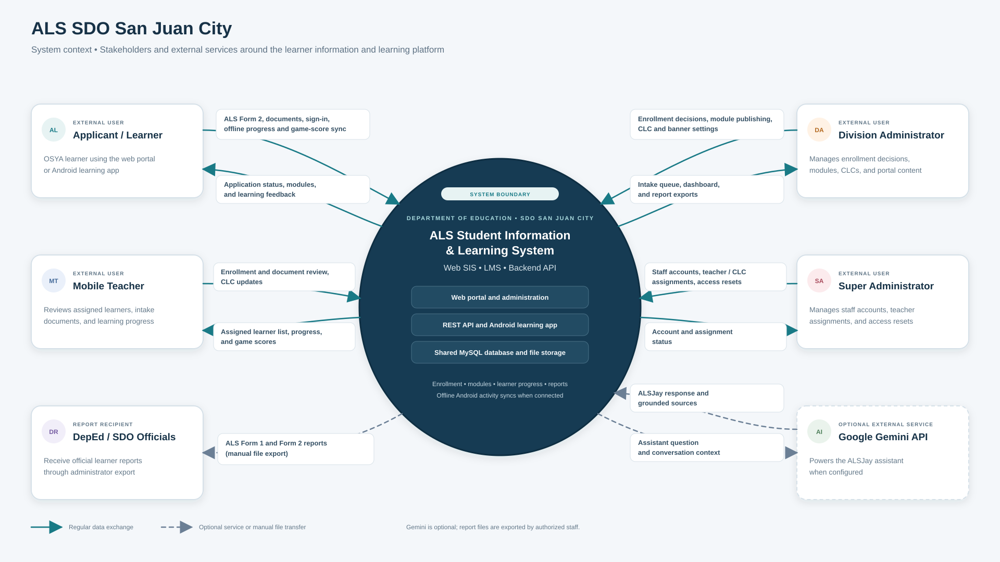
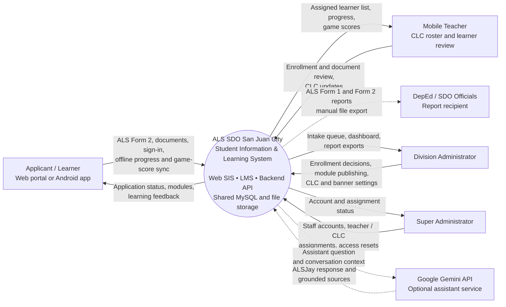

# ALS SDO San Juan City Context Diagram

The system boundary groups the web SIS and administration portal, Laravel REST API, Android learning app, shared MySQL database, and file storage. Learners may use the web portal or Android app; Android reading and game activity can sync when connectivity is available. The ALSJay assistant uses Google Gemini only when configured. DepEd ALS Form 1 and Form 2 reports are generated for staff to export as files.

## Editable diagram source

