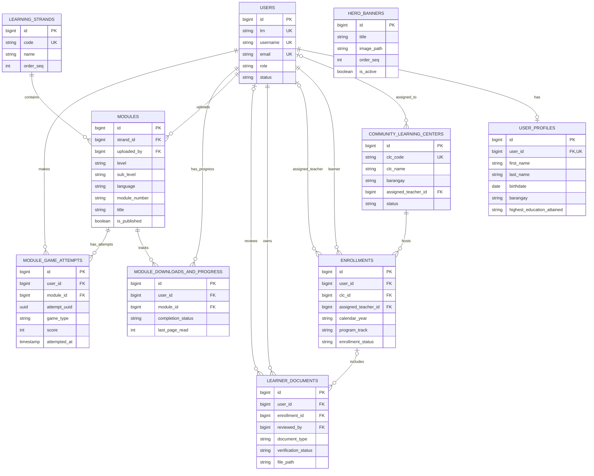

# ALS SDO San Juan City Entity Relationship Diagram

This diagram summarizes the application data model defined by the Laravel migrations. It shows primary keys, foreign keys, and the main identifying or business fields; timestamps and other non-key detail fields are omitted to keep the ERD readable. See [DATABASE_TABLES.md](DATABASE_TABLES.md) for the full column inventory.

## Relationship notes

- `USER_PROFILES.user_id` is unique, so a user has at most one profile. Each profile belongs to one user.
- Enrollment records identify a learner, a community learning center, and optionally an assigned teacher. `users` appears in more than one role because the same table stores learners and staff.
- A learner document belongs to a user and may optionally be attached to an enrollment. Its reviewer is also an optional user reference.
- `MODULE_DOWNLOADS_AND_PROGRESS` is the learner-to-module association and allows one progress row per user and module.
- `MODULE_DOWNLOADS_AND_PROGRESS` has a composite unique key on `(user_id, module_id)`; neither foreign key is unique by itself.
- `MODULE_GAME_ATTEMPTS` stores multiple attempts per learner and module. The attempt UUID is unique per user.
- `HERO_BANNERS` has no foreign-key relationships in the migrations.
- Laravel support tables are not shown. `personal_access_tokens` uses a polymorphic `tokenable_type` / `tokenable_id` pair, and the framework tables have no ERD relationship to the application data model.
